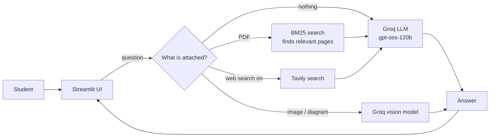

# 🎓 StudyMate AI: AI Study Assistant

An AI-powered study assistant that helps students understand topics, ask questions about their own PDFs, explain diagrams, practise with quizzes, summarize notes and plan their study days.

Built with **Python**, **Streamlit** and the **Groq API** (large language models), with **Tavily** for live web search.

**🔗 Live demo:** <!-- replace with your real app link -->

<!-- Add screenshots: create a "screenshots" folder, put images in it, then uncomment:


-->

---

## ✨ Features

| Tool | What it does |
|---|---|
| 💬 **AI Tutor** | Ask any study question and get a simple explanation with examples. Choose your level (Beginner / Intermediate / Advanced) and language (Simple English / Roman Urdu / Urdu). |
| 📄 **Chat with your PDF** | Click **+** in the chat box to attach lecture notes or a book. Ask anything about it and get answers with page numbers, e.g. *(Page 26)*. Works with long PDFs. |
| 🖼️ **Explain a diagram** | Attach an image of a graph, chart or diagram, or ask *"explain the diagram on page 12"* of your PDF. A vision model looks at the page and explains it. |
| 📝 **Quiz Generator** | Make MCQs from any topic or from your PDF. Pick the number of questions and the difficulty, submit your answers, and see your score with an explanation for every question. |
| 📖 **Notes Summarizer** | Paste notes or use a PDF. Get key points, a short summary, exam revision notes or a definitions table, and download them as a file. |
| 🗓️ **Study Planner** | Enter your subjects, exam date and daily study hours. Get a day-by-day plan, tick off finished days with a progress bar, and download the plan as a checklist. |
| 🌐 **Web search** | Turn on web search for recent information such as news or the latest software versions. Answers include their sources. |
| 🕘 **Chat history** | Conversations are saved in a SQLite database (when running locally) and listed under *Recent Chats*. |

---

## 🧠 How it works



### Answering questions about long PDFs (RAG)
Sending a whole book to the AI is too expensive, so the app uses **Retrieval-Augmented Generation (RAG)**:

1. **Load once:** when a PDF is uploaded, its text is read page by page (PyMuPDF), cut into chunks, and indexed.
2. **Outline:** an outline of the whole document is built from its table of contents (or from page titles), so the AI always knows every topic.
3. **Retrieve:** for each question, the **BM25** ranking algorithm (the classic search-engine method) finds the most relevant chunks.
4. **Generate:** the outline and the best pages are sent to the AI, which answers and cites page numbers.

Different questions get different context:
- **Small PDF:** the whole document is sent.
- **"Explain page 32":** that exact page is sent.
- **"Summarize all topics":** a little of every page is sent.
- **"What is binary search?":** the best-matching pages are sent.
- **"Explain more":** the previous question's topic is reused.

### Reliable quizzes and plans
The quiz and the study plan come back from the AI as **JSON**. The code checks every question and every day, removes broken ones, and shuffles the answer options. Study dates are calculated in Python, because language models often get calendars wrong.

---

## 🛠️ Tech stack

| Area | Tools |
|---|---|
| Language | Python |
| Web UI | Streamlit |
| AI models | Groq API: `openai/gpt-oss-120b` (text), `llama-4-scout` (vision) |
| Web search | Tavily API |
| PDF reading | PyMuPDF |
| Images | Pillow |
| Search / RAG | BM25, written from scratch (tokenization, stop words, stemming) |
| Database | SQLite |
| Logging | JSON Lines (`logs/llm_logs.jsonl`): response time and tokens of every AI request |

### AI / ML concepts used
Large language models · prompt engineering · Retrieval-Augmented Generation (RAG) · BM25 / TF-IDF ranking · NLP preprocessing · multimodal (vision) AI · structured JSON output · context window management · hallucination control.

---

## 📁 Project structure

```
AI_Study_Assistant/
├── app.py               # Streamlit UI, chat, study tool screens, database
├── pdf_tools.py         # PDF reading, chunking, BM25 search, page images
├── study_tools.py       # Prompts and answer checking for quiz, summary, planner
├── requirements.txt     # Python libraries
└── .streamlit/
    ├── config.toml      # Theme settings
    └── secrets.toml     # API keys (NOT uploaded to GitHub)
```

---

## 🚀 Run it on your computer

**1. Clone the repository**
```bash
git clone https://github.com/<G-fatima>/<AI-Study-Assistant>.git
cd <AI-Study-Assistant>
```

**2. Install the libraries**
```bash
pip install -r requirements.txt
```

**3. Add your API keys**

Create the file `.streamlit/secrets.toml`:
```toml
GROQ_API_KEY = "your-groq-key"      # free key from console.groq.com
TAVILY_API_KEY = "your-tavily-key"  # free key from tavily.com
```

**4. Start the app**
```bash
python -m streamlit run app.py
```
The app opens in your browser at `http://localhost:8501`.

---

## ☁️ Deployment

The app is deployed on **Streamlit Community Cloud**:
1. Push the code to GitHub (without `secrets.toml` and `study_assistant.db`).
2. On [share.streamlit.io](https://share.streamlit.io), create an app from this repository with `app.py` as the main file.
3. In **Advanced settings → Secrets**, add:
```toml
GROQ_API_KEY = "your-groq-key"
TAVILY_API_KEY = "your-tavily-key"
SAVE_HISTORY = false
```
`SAVE_HISTORY = false` turns off the shared chat database online, so users never see each other's conversations.

---

## ⚠️ Limitations

- Uses free API tiers, so heavy use can hit Groq or Tavily rate limits.
- Scanned PDFs need OCR (Tesseract) to be read; otherwise upload the pages as images.
- Study plans are limited to 45 days, and plan progress resets when the page is refreshed.
- PDF search is keyword-based (BM25), so it can miss questions that use different words than the PDF.

## 🔮 Future improvements

- Semantic search with embeddings and a vector database
- Saving study plans and quiz scores to the database
- User accounts with private chat history
- AI tool calling, so the assistant decides by itself when to search the web
- A weather/time tool using real APIs instead of web search

---

## 👩‍💻 Author

**Ghulam Fatima**: learning AI and machine learning by building real projects.
<!-- Add your LinkedIn / GitHub profile links here -->
